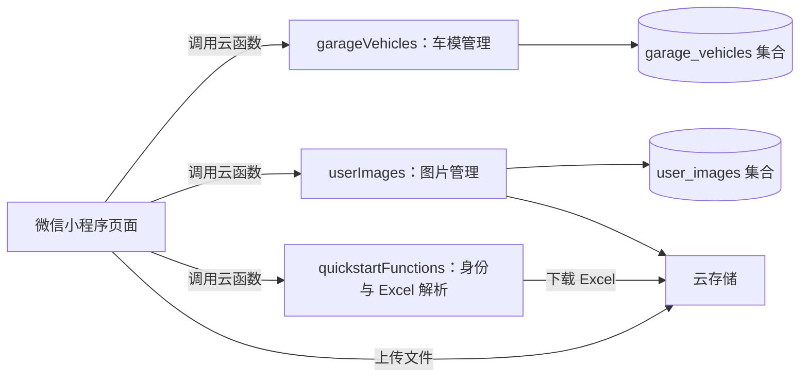

# 我的车库 · X_garge

一个用于管理个人车模收藏的微信小程序。记录车模资料与购入信息，上传收藏照片，通过搜索、分类和排序浏览车库，也可以使用 Excel 批量导入车模资料。

## 主要功能

- **收藏管理**：新增、查看、编辑和删除车模，记录车辆品牌、具体型号、车模品牌、编号、颜色、标签及备注。
- **购入记录**：记录购入日期、价格和渠道，支持渠道自由填写及快捷选择。
- **车库浏览**：关键词搜索，按车辆品牌、车模品牌、颜色和标签筛选，支持多种排序方式。
- **卡片管理**：长按卡片置顶、删除或进入拖动排序。
- **收藏照片**：支持相册和相机选择、图片压缩、上传进度、失败重试、预览与删除。
- **Excel 导入**：从微信聊天文件选择 `.xls` 或 `.xlsx`，解析并批量保存车模资料。
- **个人主页**：微信登录、昵称和头像设置、身份信息及收藏数量展示。

## 技术与架构

| 部分 | 技术 | 职责 |
| --- | --- | --- |
| 前端 | 微信原生小程序：JavaScript、WXML、WXSS、JSON | 页面展示、表单输入、搜索筛选和交互 |
| 后端 | CloudBase 云函数：Node.js、wx-server-sdk | 车模管理、用户身份校验、图片管理和 Excel 解析 |
| 数据库 | CloudBase 云数据库 | 保存车模资料和图片记录 |
| 文件存储 | CloudBase 云存储 | 保存照片及上传的 Excel 文件 |
| Excel 解析 | xlsx | 读取第一张工作表并映射字段 |



后端代码位于 `cloudfunctions/`，部署后运行在微信云端。前端通过 `wx.cloud.callFunction()` 调用后端，云函数从可信微信上下文获取 OPENID，并据此隔离不同用户的数据。

## 项目目录

```text
X_garge/
├── miniprogram/                    小程序前端
│   ├── app.js                      初始化云开发环境
│   ├── app.json                    页面注册与窗口配置
│   ├── app.wxss                    全局样式
│   ├── envList.js                  云环境列表配置
│   ├── pages/
│   │   ├── index/                  首页：车库、添加、个人主页
│   │   ├── detail/                 车模详情与图片预览
│   │   └── edit/                   编辑车模资料
│   ├── components/
│   │   ├── userImageUploader/      图片上传组件
│   │   └── cloudTipModal/          云开发提示组件（当前未使用）
│   └── assets/                     Excel 模板与预览资源
├── cloudfunctions/                 后端云函数
│   ├── garageVehicles/             车模增删改查、批量新增、排序
│   ├── userImages/                 图片上传记录、归属校验、删除
│   └── quickstartFunctions/         获取微信身份、解析 Excel
├── cloudbase/                      数据库与云存储权限规则
├── docs/                           项目框架、部署与测试说明
├── project.config.json             开发者工具项目配置
├── project.private.config.json     开发者工具本地配置
├── uploadCloudFunction.sh          quickstartFunctions 部署命令模板
├── 车模信息表.xlsx                  车模资料表
└── README.md                       项目介绍与使用指引
```

首页底部的“车库 / 添加 / 我的主页”是同一页面内的三个面板，通过 `currentTab` 切换。独立注册的页面共有三个：首页、详情页和编辑页。

## 后端模块

| 云函数 | 支持的操作 |
| --- | --- |
| `garageVehicles` | `list`、`create`、`createMany`、`update`、`delete`、`reorder` |
| `userImages` | `list`、`createUpload`、`finalizeUpload`、`cancelUpload`、`delete` |
| `quickstartFunctions` | `getOpenId`、`parseVehicleExcel` |

车模集合为 `garage_vehicles`，图片集合为 `user_images`。数据库权限规则用于禁止客户端直接读写，业务通过云函数访问；云存储权限规则用于限制用户访问自己的文件。需要在云开发控制台应用仓库中的规则文件。

## 本地运行与部署

1. 使用微信开发者工具导入仓库根目录，核对 `project.config.json` 中的 AppID。
2. 开通微信云开发并选择自己的云环境，修改 `miniprogram/app.js` 中的环境 ID；如维护环境列表，同时更新 `miniprogram/envList.js`。
3. 在云数据库中创建 `garage_vehicles` 和 `user_images` 两个集合，分别设置为仅管理端可读写，参考 `cloudbase/database.rules.json`。
4. 在云存储控制台配置 `cloudbase/storage.rules.json` 中的权限规则。
5. 分别右键 `cloudfunctions/` 下的三个云函数，选择“上传并部署：云端安装依赖”。
6. 编译小程序，并使用真机验证新增、编辑、删除、Excel 导入、图片上传及跨设备读取。

`uploadCloudFunction.sh` 当前只是 `quickstartFunctions` 的部署命令模板，包含待填写参数；部署全部功能请按上述步骤处理三个云函数。

## Excel 导入

参考 [车模信息表模板](miniprogram/assets/vehicle-template.xlsx)，在 Excel 第一张工作表中使用以下表头：

| 车模品牌 | 编号 | 车辆品牌 | 具体型号 | 颜色 | 分类标签 | 购入时间 | 购入价格 | 备注 |
| --- | --- | --- | --- | --- | --- | --- | --- | --- |

导入流程：选择聊天文件 → 上传云存储 → 云函数解析 → 生成车模记录 → 批量保存。导入记录初始不包含图片，可在编辑页补充。

## 当前实现说明

- 图片数量限制为**每个微信用户共 4 张**。组件尝试将图片压缩至 2 MB 以内。
- 车模列表单次最多读取 100 条，当前未实现分页。
- 新增和编辑支持“购入渠道”，Excel 解析暂未映射该列。
- 拖动排序已提供操作和云端写入，刷新后恢复手动顺序的链路仍待完善。
- Excel 导入的成功提示和加载状态收尾存在待修复问题，批量写入尚未提供部分失败报告。
- 删除车模当前不会自动删除关联图片，需要分别管理图片。
- 个人主页昵称、头像等登录资料保存在本地；云端数据归属由云函数上下文校验。

以上根据当前源码整理；实际部署与运行效果需在自己的云环境和真机上验证。

## 详细文档

- [项目框架说明](docs/项目框架说明.md)：目录职责、页面模块、接口、数据结构、业务流程和后续优化建议。
- [图片上传部署与测试说明](docs/CLOUDBASE_IMAGE_UPLOAD.md)：图片权限、部署步骤和测试方法；其中个人主页云端照片列表的描述尚需与当前界面同步。
