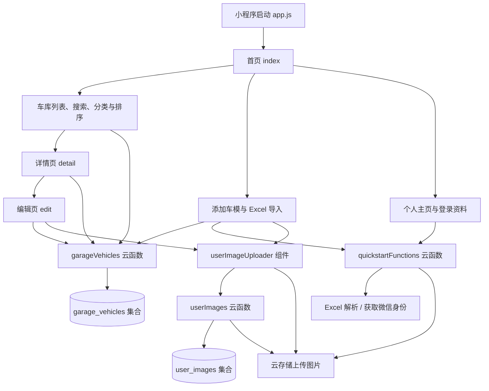

# 我的车库：项目框架说明

整理日期：2026-10-13。依据当前工作区源码整理；云端部署状态、数据库实际规则和真机运行效果未在本次核验。

## 1. 项目定位

这是一个用于管理个人车模收藏的微信原生小程序。用户可以录入车模、上传照片、搜索和分类查看收藏、查看详情、编辑或删除记录，也可以通过 Excel 批量导入。

技术组成：微信原生小程序（JavaScript、WXML、WXSS、JSON）＋微信云开发 CloudBase（Node.js 云函数、云数据库、云存储）。项目没有独立的传统后端服务器，也没有使用 Vue 或 React。

## 2. 总体结构



前端负责界面、表单、筛选和排序；云函数负责业务操作与用户身份校验；数据库保存结构化资料；云存储保存图片和上传的 Excel 文件。

## 3. 目录与文件职责

```text
x_garage/
├─ miniprogram/                  小程序前端
│  ├─ app.js                    启动并初始化云开发环境
│  ├─ app.json                  注册页面、配置窗口
│  ├─ app.wxss                  全局样式
│  ├─ envList.js                环境列表配置，当前入口未引用
│  ├─ sitemap.json              小程序搜索配置
│  ├─ pages/
│  │  ├─ index/                 首页：车库、添加、个人主页三个面板
│  │  ├─ detail/                详情展示、图片预览、编辑入口、删除
│  │  └─ edit/                  编辑资料并保存至云端
│  ├─ components/
│  │  ├─ userImageUploader/     图片选择、压缩、上传、预览与删除
│  │  └─ cloudTipModal/         云开发提示组件，当前页面未注册使用
│  └─ assets/                   Excel 模板、模板预览等资源
├─ cloudfunctions/              Node.js 云函数
│  ├─ garageVehicles/           车模增删改查、批量新增、排序
│  ├─ userImages/               图片记录、上传预留、完成确认与删除
│  └─ quickstartFunctions/      微信身份获取、Excel 解析
├─ cloudbase/                   数据库和存储权限规则文件
├─ docs/                        项目说明文档
├─ project.config.json          开发者工具项目配置
├─ project.private.config.json  开发者工具本地配置
├─ README.md                    项目介绍、框架与运行指引
├─ uploadCloudFunction.sh        quickstartFunctions 部署命令模板
├─ 车模信息表.xlsx               根目录车模资料表
└─ x_garage.rar                 压缩包，不属于小程序运行入口
```

每个页面通常由 `index.js`（逻辑）、`index.wxml`（界面）、`index.wxss`（样式）、`index.json`（页面配置）组成。首页的文件名为 `index/index.*`。

## 4. 前端功能模块

| 模块 | 所在位置 | 当前职责 |
| --- | --- | --- |
| 车库列表 | pages/index | 卡片展示、关键词搜索、按车辆品牌/车模品牌/颜色/标签分类 |
| 排序管理 | pages/index | 首字母、购入日期、车辆品牌、车模品牌排序；置顶、长按管理、拖动排序 |
| 新增车模 | pages/index | 填写资料、颜色与标签建议、购入渠道快捷输入、提交新增 |
| Excel 导入 | pages/index | 从聊天文件选择 xls/xlsx，上传并调用解析，再批量保存 |
| 个人主页 | pages/index | 微信登录、昵称、头像、身份信息展示、收藏数量；登录资料存于本地 |
| 车模详情 | pages/detail | 从云端列表定位指定 ID，展示资料与图片，支持编辑跳转和删除 |
| 编辑车模 | pages/edit | 从云端列表加载资料、回显表单、修改图片与字段、保存 |
| 图片组件 | components/userImageUploader | 相册/相机选择、压缩、上传进度、失败重试、预览、删除、向页面回传图片 |

`app.json` 注册了 3 个页面。首页底部的“车库 / 添加 / 我的主页”通过 `currentTab` 切换同一页面里的面板，没有配置原生 `tabBar`。

## 5. 云函数接口

所有接口通过 `wx.cloud.callFunction` 调用，并通过 `data.type` 分发操作。

| 云函数 | type | 用途 |
| --- | --- | --- |
| garageVehicles | list | 获取当前用户车模，当前单次最多返回 100 条 |
| garageVehicles | create | 新增一条车模记录；按用户与 ID 判断是否已存在 |
| garageVehicles | createMany | 逐条调用新增逻辑，批量保存 |
| garageVehicles | update | 更新当前用户指定 ID 的车模 |
| garageVehicles | delete | 删除当前用户指定 ID 的车模记录 |
| garageVehicles | reorder | 按 ID 数组更新各条记录的 order |
| userImages | list | 获取当前用户图片，可按 scopeId 筛选 |
| userImages | createUpload | 分配上传槽位、生成路径和 uploading 占位记录 |
| userImages | finalizeUpload | 校验归属与路径，将上传记录确认为 ready |
| userImages | cancelUpload | 取消上传，清理占位记录及匹配的文件 |
| userImages | delete | 删除本人图片文件和图片记录 |
| quickstartFunctions | getOpenId | 从微信云函数上下文获取 OPENID、APPID、UNIONID |
| quickstartFunctions | parseVehicleExcel | 下载 Excel，解析第一张工作表，按固定中文表头映射字段 |

三个云函数都依赖 `wx-server-sdk`；Excel 解析函数另外依赖 `xlsx`。依赖版本以各自 `package.json` 为准。

## 6. 数据结构与权限边界

### 车模集合 garage_vehicles

| 字段组 | 字段 | 说明 |
| --- | --- | --- |
| 标识 | id、_id | 业务 ID 与云数据库文档 ID；业务操作主要使用 id |
| 用户归属 | openid、_openid | 云函数从可信微信上下文写入，用于用户隔离 |
| 图片 | images、coverImage | 图片列表、封面；一般第一张为封面 |
| 型号信息 | specificModel、modelBrand、serialNumber、vehicleBrand | 具体型号、车模品牌、编号、车辆品牌 |
| 分类信息 | color、tags | 颜色字符串与标签数组；前端生成展示用辅助字段 |
| 购入信息 | purchaseDate、purchasePrice、purchaseChannel | 时间、价格、渠道；当前表单主要使用文本值 |
| 管理信息 | note、isPinned、order | 备注、置顶状态、手动排序位置 |
| 时间 | createdAt、updatedAt | 云数据库服务端时间 |

### 图片集合 user_images

主要字段为 `_id`、`openid`、`_openid`、`fileID`、`cloudPath`、`scopeId`、`slot`、`status`、`safetyStatus`、`createdAt`、`uploadedAt`。

`scopeId` 对应车模 ID；`slot` 是账号内上传槽位；`status` 为 uploading 或 ready。当前云函数限制是每位用户共 4 张图片，而非每台车 4 张。组件尝试将图片压缩到 2 MB 以内，这不是服务端强制文件大小限制。

数据库规则文件禁止客户端直接读写，业务经云函数操作。云函数依据上下文 OPENID 校验记录归属。存储规则文件要求文件归属与访问者身份一致。规则文件存在不代表已在云控制台生效。

个人主页的登录资料保存在本地 `garageLoginProfile`；云端业务鉴权使用可信微信上下文，与页面显示的登录资料分别处理。车模主数据读取已走云端；代码仍保留 `garageVehicles` 本地缓存辅助逻辑，编辑页部分颜色/标签建议仍读取该本地缓存。

## 7. 主要业务流程

**新增车模：** 切换添加面板 → 填表与选择图片 → 图片组件完成上传并回传 fileID → 以 draftVehicleId 为业务 ID 调用 garageVehicles.create → 更新首页显示。

**查看与编辑：** 点击车模卡片 → 带 id 跳转详情页 → 从 garageVehicles.list 返回的列表中查找该车模 → 跳转编辑页 → 回显并修改 → 调用 update → 返回后重新读取云端资料。

**Excel 导入：** chooseMessageFile 选择文件 → 上传到 vehicle-import 路径 → quickstartFunctions.parseVehicleExcel 下载并解析 → 首页 buildImportedVehicles 生成业务对象与 ID → garageVehicles.createMany 批量写入 → 更新列表。

当前识别表头：车模品牌、编号、车辆品牌、具体型号、颜色、分类标签、购入时间、购入价格、备注。前端对象支持 purchaseChannel，但解析端 HEADER_MAP 尚未包含“购入渠道”。导入记录初始没有图片。

**图片上传：** 选择与压缩 → createUpload 预留槽位 → 前端 uploadFile 上传 → finalizeUpload 校验并确认 → change 事件回传 images 与 coverImage。失败时可取消占位或重试。

## 8. 当前结构中值得后续整理的部分

以下是源码观察与后续建议，本次仅整理文档。

| 现状 | 影响及建议 |
| --- | --- |
| 首页 index.js 同时处理列表、表单、登录、导入和拖动 | 后续可按职责拆成服务和工具模块，减少单个文件的维护负担 |
| 多个页面重复定义 callGarageVehicles、normalizeVehicle 和标签处理 | 可提取统一接口封装与字段规范化，降低新增字段时漏改的概率 |
| reorder 写入 order，但 list 没有按 order 查询，首页规范化也未保留 order | 当前拖动后的即时显示与刷新后排序之间缺少完整恢复链路，应补齐 |
| list 固定 limit(100)，详情和编辑也通过 list 找记录 | 应增加分页和按 ID 查询，支持更大的收藏规模 |
| 表单支持购入渠道，Excel HEADER_MAP 尚未映射 | 应同步导入映射与模板列定义 |
| 导入成功提示位于 return 之后 | 当前成功路径中的 hideLoading 与成功提示不可达，应调整 Promise 回调位置 |
| 编辑页部分建议仍读取本地缓存 | 建议统一使用已加载的云端列表或明确更新缓存 |
| 删除车模与删除图片是两个独立接口 | 删除车模当前没有同步清理图片记录和云文件，应明确图片生命周期 |
| Excel 导入上传的文件未在该链路中删除 | 可在解析结束后清理临时文件 |
| createMany 逐条写入，未提供事务或部分失败报告 | 导入可能部分落库，后续可增加逐行结果、批次标识及重试策略 |
| 部署脚本、调试入口还保留 quickstart 痕迹 | README 已更新为业务说明；脚本目前仅覆盖一个云函数，配置还含旧 databaseGuide 调试入口 |
| 图片部署文档称个人主页有云端照片列表 | 当前首页 WXML 的个人主页未包含该列表，文档需要与界面同步 |

如果后续做代码结构优化，可逐步增加 `services/garage.js`、`services/images.js`、`services/import.js`、`utils/vehicle.js` 与 `constants/vehicle.js`；这些是建议目录，当前项目尚未创建。

## 9. 阅读与运行准备

建议阅读顺序：`project.config.json` → `miniprogram/app.js` 与 `app.json` → 首页 → 详情与编辑 → `garageVehicles` → 图片组件与 `userImages` → Excel 解析 → 权限规则。

运行准备：在微信开发者工具打开项目；核对 app.js 的云环境；创建 garage_vehicles 和 user_images 集合；应用数据库/存储规则；部署三个云函数并安装各自依赖；再进行真机的新增、编辑、导入、图片上传和跨设备读取验收。

本说明完成了本地结构和调用链核对，没有验证上述云端部署与真机流程。

